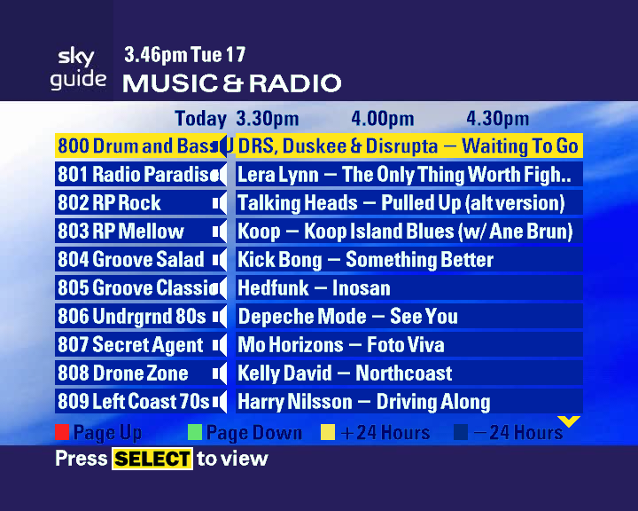
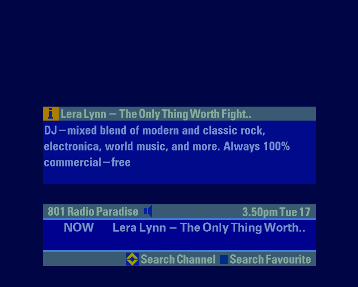

# Pace 2500N Sky Digibox for MiSTer — user guide

A MiSTer FPGA core that runs the **genuine Pace 2500N (Sky Digibox) firmware**:
the real Sky Guide boots, reads its listings from a transport stream and plays
MPEG-2 video with MP2 sound through the box's own decoder path. Channels are
served live from your PC (and optionally your Plex library), transcoded only
while the box is tuned to them, with period adverts and continuity between
programmes.

**Current development build: V080B + Channel Builder 0.8.0B**, on the
[`cold-boot` branch](https://github.com/retrorepair/Pace2500N-MiSTer/tree/cold-boot),
tested on 22 November 2026. The firmware cold-boots entirely in FPGA from the
original flash image, with an EEPROM save and live transport stream.
**No `RAM.bin` or `STATE.bin` checkpoint is loaded.**

This build adds live Teletext pages, page 888 text subtitles and automatic
cropping of 4:3 programmes stored inside a 16:9 picture. All 48 non-HDMI timing
checks and two four-minute hardware tests passed. Guide backgrounds and the
corner logo survive a trip to live TV and back. Boot remains slow; physical-TV
checks of the new live clock and timed subtitle overlay are still pending.

**Downloads:** [V080B / v0.8.0-beta.2](https://github.com/retrorepair/Pace2500N-MiSTer/releases/tag/v0.8.0-beta.2)
contains the tested `Pace2500N_V080B.rbf`, matching Live launcher and relay,
Channel Builder 0.8.0B Windows app, and `SHA256SUMS.txt`. This is a prerelease;
v0.7.5 remains the latest stable release. Older v0.7.x packages use their own matching launcher/app and
[checkpoint-era instructions](https://github.com/retrorepair/Pace2500N-MiSTer/blob/v0.7.7-rc3/README.md).
The installation instructions below describe V080B from this branch.

For continuation and detailed validation, see [current status](CURRENT_STATUS.md),
[handoff](handoff.md), [live Teletext](LIVE_TELETEXT.md) and the
[expansion plan](EXPANSION_PLAN.md).

## Screenshots

V080B's native firmware Guide after returning from a TV channel, captured on MiSTer:


Earlier captures from v0.7.7-rc2 show the existing Guide and playout features:

| | |
|---|---|
|  TV Guide |  All Channels |
|  7-day listings (+24 Hours) |  Genre page |
|  Music & Radio with live track titles |  Programme synopsis from Plex |
|  Internet radio station tuned |  IPTV channel with its own guide (Pluto TV) |

## What works

| Area | State |
|------|-------|
| Firmware boot, Sky Guide, listings (TV Guide, A–Z, All Channels) | working |
| Cold boot without RAM/CPU checkpoints | **V080B:** original flash, EEPROM save and live TS; CPU execution entirely in FPGA |
| Guide background and corner logo after returning from TV | **V080B:** first and return Guide screenshots are pixel-identical |
| Running broadcast clock (from the MiSTer's RTC) | working |
| MPEG-2 video + MP2 audio, selected by the firmware when you pick a channel | working (v0.5.8+) |
| Streaming from the server share (file mode, any length) | working (v0.5.9; v0.6.1 adds tuner lock) |
| **Live channels from the PC playout server** — guide listings, channel numbers, now/next banner | **working (v0.6.1)** |
| Live channels — picture and sound of the channel you select, changing channel | **working (v0.6.2)** — the MPEG decoder's interrupts and header registers are now modelled |
| Core contains no firmware (boots from the flash dump it loads) — downloadable | **v0.6.3** |
| Pipelined NEC VR4110 implementation with instruction/data caches and MIPS16 | Current cold-boot build runs the CPU at **67.5 MHz** |
| Keys respond straight away; TV Guide, Box Office and Services menus; back to the Guide from a channel | **working (v0.7.0)** |
| Interactive | shows the firmware's "no interactive services available" (none are broadcast) |
| Typing a channel number | **working** with the current Channel Builder (17 Nov): TV and radio. Each channel needs its own number - Channel Builder refuses a number that is already used |
| Guide genre pages (Movies, Entertainment, ...) | working: each channel's **Guide genre** in Channel Builder, Automatic from Plex by default (Movies and Entertainment verified) |
| Live TV channels from internet streams (IPTV) | working (Channel Builder **Add IPTV**): picture, sound, typed number, banner; schedule and synopses from XMLTV, automatic for ~100 UK channels (Pluto TV, Plex, Samsung TV Plus) |
| Reminders | working from the Guide grids, the genre pages and the channel banner: Select on a future programme adds it to the Personal Planner, overlaps get the box's own Reminder Clash screen, bookings survive changing channel, and at the start time the box shows "This programme is about to start" with Select to switch channel. Kept over a MiSTer power cycle from core V078 (EEPROM save file), being tested |
| Widescreen pictures on a 4:3 TV | MiSTer OSD option **Widescreen on 4:3** letterboxes 16:9 and wider (v0.7.6) |
| 4:3 programmes inside 16:9 files | **0.8.0B app:** background analysis detects sustained side bars and caches a crop; applies to scheduled files/Plex |
| Sound recovering after a damaged MP2 frame | about 50-75 ms instead of silence for the rest of the stream (v0.7.7, verified in simulation) |
| TV sound in the EPG | muted while the firmware tunes to the Guide transponder |
| Plex library as a programme source (single titles or whole libraries) | working (Sky Movies from Plex, v0.7.0) |
| 7-day listings | working: set **Days of listings** to 7 in Channel Builder's Settings. A day not viewed yet fills within a few seconds of opening it |
| Programme synopsis (Information button) | working while tuned and in the grid for Plex titles that have a summary (cut to 255 characters, the box's limit) |
| EPG background music | the updated relay keeps music playing across Guide, All Channels, Box Office and Services when a period audio file is configured. Sky returns to the TV channel. Background Music is in Services > System Setup > Sound Settings |
| Teletext over RGB SCART | Fixed page body/colours decoded on the user's Sony CRT with MiSTer Pi analogue I/O; V080B adds live transport-fed pages |
| Page 888 subtitles | English text/Teletext extraction verified with real Plex SRT and IPTV WebVTT; FPGA packet path tested. Physical-TV overlay/timing feedback pending; **no OCR** |
| Full A/V lip-sync | still unfinished |

## How it fits together

```
 Plex / files ──► PC: playout server ──► network ──► MiSTer HPS: relay ──► /tmp ring ──► core ──► firmware
 (sources)        (transcode on demand,               (pace_live_relay.py)  (image slot)   (demux,
                   guide data, adverts)                                                     MPEG decoder)
```

- **Channels are pure metadata** — a JSON line-up listing each channel's
  programmes, style and interstitial sets. No video files are made.
- **The box tunes, the PC plays.** When the firmware routes a channel's PIDs to
  its decoder, the core reports them; the relay asks the PC for that channel;
  the PC transcodes *what the schedule says is on now* and streams it. Change
  channel or leave the core and the transcode stops. Nothing is "on air" unless
  the box has tuned it. The home transponder carries listings and configured
  Guide music. The playout server levels programmes and breaks toward −24 LUFS
  and Guide music toward −34 LUFS.
- **Period breaks.** ITV-style channels get centre and end breaks of real
  period adverts; Sky-style channels get Sky-length breaks; BBC-style channels
  get continuity (announcers, trailers, idents) and no adverts. Breaks are
  contiguous runs of spots exactly as they were recorded off air.
- **Live Teletext.** The PC multiplexes text pages and available subtitle cues
  into the same transport. The FPGA inserts them into the analogue VBI alongside
  RGB. The TV decodes the pages; firmware execution remains in FPGA.

## 1. Install the core on the MiSTer

Download V080B from the release above (or build this branch), then copy these
files to the MiSTer SD card:

| File | Where |
|------|-------|
| `Pace2500N_V080B.rbf` | `/media/fat/_Other/` |
| [`Pace2500N_V080B_Live.mgl`](Pace2500N_V080B_Live.mgl) | `/media/fat/_Other/` |
| Your firmware `FLASH_U202.bin` | `/media/fat/games/Pace2500N/` |
| `EEPROM.bin` (64 KiB persistent save) | `/media/fat/games/Pace2500N_GUIDE/` |

Supply your own original 2 MiB U202 firmware image; firmware is not distributed.
The relay installer in step 3 creates the EEPROM save if it is missing and
preserves an existing one. The launcher mounts `/tmp/pace_live.ts`, which the
relay creates. Complete the relay setup before loading the launcher.

Leave **Boot: Cold from flash** selected in the OSD. The V080B launcher loads
no RAM or CPU-state checkpoint. Existing V080A launchers can be retained as a
fallback. The firmware starts from reset and takes time to initialise.

## 2. The Windows app: Pace Channel Builder

A normal Windows program - nothing else to install (Python, ffmpeg and yt-dlp
are inside its folder).

- **Get it:** unzip `PaceChannelBuilder-v0.8.0-beta.2-windows.zip` from the
  [V080B release](https://github.com/retrorepair/Pace2500N-MiSTer/releases/tag/v0.8.0-beta.2)
  into your chosen location, for example `C:\Pace2500N`. Run
  `PaceChannelBuilder.exe` and keep the whole folder together, including
  `_internal\` and `tools\`. Older v0.7.x Windows packages do not contain the
  new Teletext/subtitle features.
- **Run it:** *Pace Channel Builder* on the Desktop / Start menu, or
  `PaceChannelBuilder.exe` in that folder.
- **Upgrading:** close the app (it asks first while playout is running - the
  box loses its channels until you reopen it), replace the folder, start it
  again. Your settings, line-ups and adverts are kept (they are not in the
  app folder).
- **If something goes wrong:** the app writes `%APPDATA%\Pace2500N\app.log`
  (everything it did, errors, and a full dump if playout stops answering).
  The *Playout* tab shows whether the box is connected and when it last was.
- **Plex:** *Settings* tab -> **Sign in with Plex...**. Your browser opens Plex's
  own sign-in page; approve *Pace Channel Builder* and the app receives the
  token and finds your server by itself. You never copy a token by hand.
  (*Test connection* lists your libraries.)
- **Firmware image:** in Settings, select the original `FLASH_U202.bin` for
  guide-text encoding. A RAM checkpoint is not needed by the current app.
- **Playout runs inside the app** and starts when the app opens (tick box in
  Settings). The *Playout* tab shows what each channel is showing and what is
  being streamed to the box. Keep the app open while you use the box.
- First time only: allow it through Windows Firewall if asked (the MiSTer
  connects to port 8250).
- Settings normally live in `%APPDATA%\Pace2500N\settings.json`. Optional
  portable mode uses `data\settings.json` when an empty `portable.flag` file
  exists beside the executable. The *Data folder* holds line-ups and `roms\`
  (ripped adverts); copying the app does not copy your media library or firmware.
- **New settings:** enable live Teletext, page 888 subtitles, internet pages
  and automatic 4:3 pillarbox removal as needed. Subtitle delay is adjustable
  from −10 to +10 seconds, initially +0.7. These are this app's settings and do
  not change Plex's general audio/subtitle preferences.

To rebuild the app from source: `tools\build_app.bat` (needs Python,
PyInstaller and a gyan.dev FFmpeg release-essentials build extracted under
`third_party\` on the build machine only; close the app first).

## 3. Install the relay on the MiSTer (once)

The two files are in the MiSTer files zip (or
`tools/mister/` in the source). From that folder on the PC (`MISTER` is the
MiSTer's address; the last address is your PC's LAN address, which the app's
Playout tab shows):

```bash
scp pace_live_relay.py install_relay.sh root@MISTER:/tmp/
```

```bash
ssh root@MISTER "sh /tmp/install_relay.sh YOUR_PC_LAN_IP:8250"
```

This puts the relay in `/media/fat/linux/pace/`, writes `relay.ini` (the PC
address — edit it if your PC's address changes) and adds one line to
`/media/fat/linux/user-startup.sh` so it starts at boot. It is idle until the
Pace core runs. Its log is `/tmp/pace_live_relay.log`. To upgrade, run the same
two commands with the new files; the old relay is stopped first.

## 4. Build channels

In the app:

- **Channels** - *Add* a channel; set its name, number, **style** (BBC style:
  continuity, no adverts / ITV style: terrestrial advert breaks / Sky style:
  satellite breaks), when its broadcast day starts, and tick the advert /
  continuity sets it uses. Add programmes with *Add files...* or
  *Add from Plex...* (pick a library, then a show and episodes - or **Add the
  whole library**: every film, or every episode of a TV library). The list
  repeats to fill the day. **Every change is saved as you make it** (the line-up
  file is shown at the top of the tab; a new one is `roms\lineup.json`), and a
  running playout picks it up a couple of seconds later - no Save or restart
  needed. A channel with no programmes yet stays off air.
- **Adverts & continuity** - search YouTube (e.g. `TVS adverts 1987`,
  `BBC1 continuity 1989`, `Sky One adverts 1994`), select results and *Rip
  selected* into a set named for the station and years. Videos you downloaded
  yourself go in with *Import videos into set...*.
  Long compilations (a whole evening's breaks in one video) are split
  automatically at the cuts between items - black frames with silence, black
  frames alone on hissy tapes, announcer pauses in long continuity. Select a set
  to see every spot with its time and length: *Play* (or double-click) previews
  it, *Exclude / include* drops anything that is not an advert, ident or
  continuity. Breaks use runs of spots exactly as they were broadcast, and never
  run across an excluded or over-long segment (e.g. a programme excerpt).
- **Live TV channels (IPTV)** - on the **Channels** tab choose **Add IPTV**. A picker loads an
  [iptv-org](https://github.com/iptv-org/iptv) country list (UK by default); search it, keep
  *Official sources only* ticked, select channels and **Add selected**. Each gets a Guide genre
  from the list's category and a number in Sky's block for it (Kids 601+, Movies 301+, Sports
  401+, News 501+, Entertainment 101+), and the stream is checked (see the Playout log). Or use
  *Paste a stream URL instead* for any `.m3u8` or MPEG-TS address. Use official free channels, e.g. from the
  [Free-TV](https://github.com/Free-TV/IPTV) or [iptv-org](https://github.com/iptv-org/iptv)
  lists (Pluto TV, Samsung TV Plus, the BBC's own UK streams); many other entries in those lists
  are unofficial re-streams of paid channels. The stream is converted only while the box is
  tuned to it. The picker's *Listings* column shows which channels come with a programme
  guide: their real schedule and synopses are fetched automatically from the XMLTV guides
  [i.mjh.nz](https://i.mjh.nz) publishes for Pluto TV, Plex, Samsung TV Plus and others
  (about 100 of the ~170 official UK channels), matched by the channel's iptv-org id. For any
  other stream add `"epg": {"url": "<XMLTV file>", "id": "<channel id>"}` to the channel in the
  line-up file. Without a guide the Guide rows read "Live TV". Tested: Pluto TV Retro Toons on
  601 and Tiny Pop on 602, with listings on All Channels and the Kids page and synopses in Info.
- **Internet radio** - open the **Music & Radio** tab. Choose *Add starter
  stations* for channels 801–809, or *New* to enter a channel number in
  800–899, a station name and a direct HTTP(S) audio-stream URL. *Save station*
  adds it to the current line-up. On the MiSTer, use **TV Guide → Music &
  Radio** (F1, then 7) or enter the channel number. The updated Playout app
  and MiSTer relay send audio to the existing v0.7.4 core when you tune a
  station. The app polls the stream for ICY metadata while playout is running.
  A station's current track appears in the app and in the Guide's current
  slot. Reopen Music & Radio to refresh the firmware's grid. Other slots and
  stations without track metadata show *Live Radio*.
- **Schedule** - *Show today's guide* lists exactly what the box will show.
  *Find natural breaks* (once per programme, slow) moves ITV/Sky centre breaks
  to the programme's own fade-to-black points.

For scripting there are command-line equivalents (`tools/pace_channels.py`,
`tools/pace_playout.py`); a sample line-up is `tools/lineup.example.json`.
`tools/radio.example.json` is a sample value for the line-up's `radio` field.

## 5. Watch

1. Open **Pace Channel Builder** on the PC (playout starts with it).
2. On the MiSTer load your matching **Pace2500N Live** launcher. The core
   cold-boots the firmware and starts gathering listings. Allow time for
   initialisation; startup and initial Guide acquisition are still slow.
3. Press **TV Guide** (F1), choose **All Channels**, highlight a channel and
   press **Select** (Enter). After a few seconds (the PC starts the transcode at
   the scheduled point) the picture and sound appear.
   Keyboard/IR remote mapping: [KEYBOARD_REMOTE_MAP.md](KEYBOARD_REMOTE_MAP.md).
4. To change channel, press TV Guide again and pick another one.

Channel numbering in the line-up maps to the box's services: channel *n*
(0-based) is SID 1001+n, video PID 0x200+0x10·n, audio PID 0x102+0x10·n.

## 6. Teletext, subtitles and picture fit

Use a Teletext-capable TV with the analogue RGB/SCART output and composite sync
(`composite_sync=1`). In the core OSD, **Live Teletext: On** is the default.
Use the **TV's own Text and page-number controls**:

| Page | Contents |
|---|---|
| 100 | Index |
| 101 | Receiver test with a changing clock |
| 200 onward | Current channel now/next listings, four channels per page |
| 300 | BBC News headlines |
| 400 | Weather from the approximate public-IP location |
| 500 | Recent official MiSTer Main commits |
| 888 | English subtitles, where a usable track exists |

F11 starts/cancels the original **fixed** page 100 test for 30 seconds; live
pages resume afterwards. F8/T is the Pace firmware's Text command. See
[LIVE_TELETEXT.md](LIVE_TELETEXT.md) for the distinction and full setup.

Plex supports usable text tracks such as SRT. IPTV needs separate text captions
(for example WebVTT) or a Teletext subtitle stream. There is **no OCR** for
image-only PGS/VobSub/DVB bitmap subtitles, and no text extraction from burned-in
captions. English text is selected rather than substituting foreign-language
tracks. The tested Red Dwarf rip has English PGS and Czech SRT, so it needs an
English text track for page 888. TV subtitle overlay timing still needs feedback.

News, weather and MiSTer pages refresh in the background; a failed feed retains
its last successful page with a fetch time or shows an unavailable message.
Weather estimates location from the PC connection's **public egress IP**, not
the router's private address. A VPN or ISP location can affect that estimate.

**Fill 4:3 programmes stored inside a 16:9 picture** analyses scheduled files
and Plex sources in the background. Three separated samples must agree before
the side bars are cropped. Results are cached; an uncached title may need a
retune or the next programme start after analysis. Genuine wide material keeps
the OSD letterbox behaviour. Live IPTV is not automatically cropped by this
feature. A real Red Dwarf source was detected as 1440×1080 inside 1920×1080.

## Troubleshooting

| Symptom | Check |
|---------|-------|
| Guide has no listings | Is the app open with playout *Running*? `/tmp/pace_live_relay.log` on the MiSTer shows `tuned:` lines and connection errors. |
| Relay can't reach the PC | `relay.ini` address (the app shows this PC's address on its Playout tab); Windows Firewall rule for the app on port 8250. |
| Picture freezes | Status page *Streaming* section; network speed (6.25 Mbit/s needed). |
| Wrong programme for the time | The MiSTer's clock (RTC) drives the guide; the PC uses its own clock — keep both on NTP. |
| Teletext stays on the old fixed test | Wait for the F11 test window to finish, then select page 101 to check live updates. |
| Page 888 is empty | Check for a usable English text/Teletext track and that subtitles are enabled in the app. Image-only tracks are not converted. |
| Caption timing is off | Adjust **Subtitle delay** in app Settings; report the source and observed offset. |
| 4:3 programme still has side bars | Allow background analysis to complete, then retune. Detection is conservative and applies to scheduled files/Plex. |

## Building the core

Quartus Prime Lite 17.0.2 (Cyclone V).

The checked-in root project builds V080B. Its VHDL CPU is in `rtl/r4k/`;
see [upstream notes](rtl/r4k/UPSTREAM.md). Use the checked-in QSF: tested seed 6,
`PACE_TELETEXT_TEST=1` and `PACE_TELETEXT_LIVE=1`. Older project generators
produce earlier configurations. Load original flash and the EEPROM save at
runtime; no RAM/CPU checkpoint is required.

```text
quartus_sh --flow compile Pace2500N
quartus_cpf -c -o bitstream_compression=on output_files/Pace2500N.sof output_files/Pace2500N_V080B.rbf
```

The tested build uses 37,772/41,910 ALMs, 448/553 RAM blocks and 110/112 DSPs.
All 48 non-HDMI timing checks passed (minimum setup +0.717 ns, hold +0.225 ns).
Two 240-second hardware captures verified original flash, continuing firmware
execution without a CPU halt, live VBI traffic and native navigation. TV-decoded
live refresh and timed subtitles remain separate physical-display checks.

Older development tops (`rtl/Pace2500N.sv`, `rtl/Pace2500N_Guide.sv`) still
cold-boot from an in-fabric boot ROM: make it from your own dump with
`python tools/make_bootrom.py` (writes `rom/bootloader_words.hex`). Those
builds contain firmware and must not be shared.

Development build trees live in `builds/` (not in git). Simulation benches are
in `sim/` (`iverilog -g2012`; e.g. `sim/tb_ts_live.sv`, `sim/tb_ts_stream.sv`).
The v0.7.0 CPU has its own: `sim/r4k/` (GHDL, the CPU alone against a reference
trace) and `sim/vl/` (Verilator: the CPU in the whole system with a transport
stream, checked instruction by instruction against the old CPU; `sim/vl/build.sh`).

The MPEG-2 decoder is from MiSTer_DVD (mpeg2fpga, GPL-3). The MiSTer
framework in `sys/` is GPL; see `LICENSE`.
