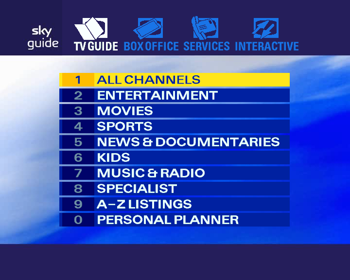
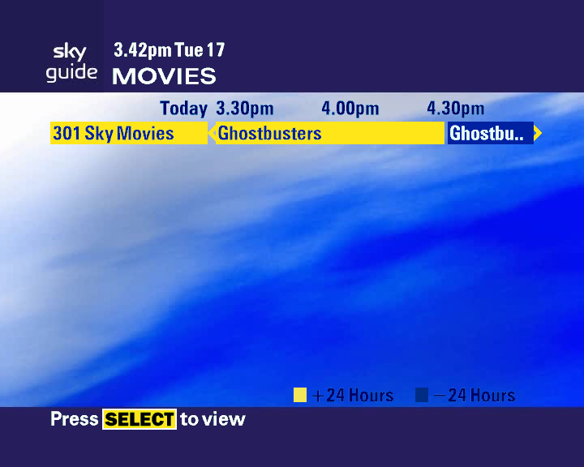

# Pace 2500N Sky Digibox for MiSTer — user guide

A MiSTer FPGA core that runs the **genuine Pace 2500N (Sky Digibox) firmware**:
the real Sky Guide boots, reads its listings from a transport stream and plays
MPEG-2 video with MP2 sound through the box's own decoder path. Channels are
served live from your PC (and optionally your Plex library), transcoded only
while the box is tuned to them, with period adverts and continuity between
programmes.

**Current development build: V080B + Channel Builder 0.8.0B**, on the
[`cold-boot` branch](https://github.com/retrorepair/Pace2500N-MiSTer/tree/cold-boot),
tested on 22 November 2026. The firmware cold-boots entirely in FPGA from the
original flash image, with an EEPROM save and live transport stream.
**No `RAM.bin` or `STATE.bin` checkpoint is loaded.**

This build adds live Teletext pages, page 888 text subtitles and automatic
cropping of 4:3 programmes stored inside a 16:9 picture. All 48 non-HDMI timing
checks and two four-minute hardware tests passed. Guide backgrounds and the
corner logo survive a trip to live TV and back. Boot remains slow; physical-TV
checks of the new live clock and timed subtitle overlay are still pending.

**Downloads:** [V080B / v0.8.0-beta.2](https://github.com/retrorepair/Pace2500N-MiSTer/releases/tag/v0.8.0-beta.2)
contains the tested `Pace2500N_V080B.rbf`, matching Live launcher and relay,
Channel Builder 0.8.0B Windows app, and `SHA256SUMS.txt`. **V080B is the latest
full release**, with GitHub's prerelease flag cleared. The existing tag and
asset names are retained to preserve download links. Older v0.7.x packages use their own matching launcher/app and
[checkpoint-era instructions](https://github.com/retrorepair/Pace2500N-MiSTer/blob/v0.7.7-rc3/README.md).
The installation instructions below describe V080B from this branch.

For continuation and detailed validation, see [current status](CURRENT_STATUS.md),
[handoff](handoff.md), [live Teletext](LIVE_TELETEXT.md) and the
[expansion plan](EXPANSION_PLAN.md).

## Screenshots

V080B's native firmware Guide after returning from a TV channel, captured on MiSTer:



Earlier captures from v0.7.7-rc2 show the existing Guide and playout features:

| | |
|---|---|
|  TV Guide |  All Channels |
|  7-day listings (+24 Hours) |  Genre page |
|  Music & Radio with live track titles |  Programme synopsis from Plex |
|  Internet radio station tuned |  IPTV channel with its own guide (Pluto TV) |

## What works

| Area | State |
|------|-------|
| Firmware boot, Sky Guide, listings (TV Guide, A–Z, All Channels) | working |
| Cold boot without RAM/CPU checkpoints | **V080B:** original flash, EEPROM save and live TS; CPU execution entirely in FPGA |
| Guide background and corner logo after returning from TV | **V080B:** first and return Guide screenshots are pixel-identical |
| Running broadcast clock (from the MiSTer's RTC) | working |
| MPEG-2 video + MP2 audio, selected by the firmware when you pick a channel | working (v0.5.8+) |
| Streaming from the server share (file mode, any length) | working (v0.5.9; v0.6.1 adds tuner lock) |
| **Live channels from the PC playout server** — guide listings, channel numbers, now/next banner | **working (v0.6.1)** |
| Live channels — picture and sound of the channel you select, changing channel | **working (v0.6.2)** — the MPEG decoder's interrupts and header registers are now modelled |
| Core contains no firmware (boots from the flash dump it loads) — downloadable | **v0.6.3** |
| Pipelined NEC VR4110 implementation with instruction/data caches and MIPS16 | Current cold-boot build runs the CPU at **67.5 MHz** |
| Keys respond straight away; TV Guide, Box Office and Services menus; back to the Guide from a channel | **working (v0.7.0)** |
| Interactive | shows the firmware's "no interactive services available" (none are broadcast) |
| Typing a channel number | **working** with the current Channel Builder (17 Nov): TV and radio. Each channel needs its own number - Channel Builder refuses a number that is already used |
| Guide genre pages (Movies, Entertainment, ...) | working: each channel's **Guide genre** in Channel Builder, Automatic from Plex by default (Movies and Entertainment verified) |
| Live TV channels from internet streams (IPTV) | working (Channel Builder **Add IPTV**): picture, sound, typed number, banner; schedule and synopses from XMLTV, automatic for ~100 UK channels (Pluto TV, Plex, Samsung TV Plus) |
| Reminders | working from the Guide grids, the genre pages and the channel banner: Select on a future programme adds it to the Personal Planner, overlaps get the box's own Reminder Clash screen, bookings survive changing channel, and at the start time the box shows "This programme is about to start" with Select to switch channel. Kept over a MiSTer power cycle from core V078 (EEPROM save file), being tested |
| Widescreen pictures on a 4:3 TV | MiSTer OSD option **Widescreen on 4:3** letterboxes 16:9 and wider (v0.7.6) |
| 4:3 programmes inside 16:9 files | **0.8.0B app:** background analysis detects sustained side bars and caches a crop; applies to scheduled files/Plex |
| Sound recovering after a damaged MP2 frame | about 50-75 ms instead of silence for the rest of the stream (v0.7.7, verified in simulation) |
| TV sound in the EPG | muted while the firmware tunes to the Guide transponder |
| Plex library as a programme source (single titles or whole libraries) | working (Sky Movies from Plex, v0.7.0) |
| 7-day listings | working: set **Days of listings** to 7 in Channel Builder's Settings. A day not viewed yet fills within a few seconds of opening it |
| Programme synopsis (Information button) | working while tuned and in the grid for Plex titles that have a summary (cut to 255 characters, the box's limit) |
| EPG background music | the updated relay keeps music playing across Guide, All Channels, Box Office and Services when a period audio file is configured. Sky returns to the TV channel. Background Music is in Services > System Setup > Sound Settings |
| Teletext over RGB SCART | Fixed page body/colours decoded on the user's Sony CRT with MiSTer Pi analogue I/O; V080B adds live transport-fed pages |
| Page 888 subtitles | English text/Teletext extraction verified with real Plex SRT and IPTV WebVTT; FPGA packet path tested. Physical-TV overlay/timing feedback pending; **no OCR** |
| Full A/V lip-sync | still unfinished |

## How it fits together

```
 Plex / files ──► PC: playout server ──► network ──► MiSTer HPS: relay ──► /tmp ring ──► core ──► firmware
 (sources)        (transcode on demand,               (pace_live_relay.py)  (image slot)   (demux,
                   guide data, adverts)                                                     MPEG decoder)
```

- **Channels are pure metadata** — a JSON line-up listing each channel's
  programmes, style and interstitial sets. No video files are made.
- **The box tunes, the PC plays.** When the firmware routes a channel's PIDs to
  its decoder, the core reports them; the relay asks the PC for that channel;
  the PC transcodes *what the schedule says is on now* and streams it. Change
  channel or leave the core and the transcode stops. Nothing is "on air" unless
  the box has tuned it. The home transponder carries listings and configured
  Guide music. The playout server levels programmes and breaks toward −24 LUFS
  and Guide music toward −34 LUFS.
- **Period breaks.** ITV-style channels get centre and end breaks of real
  period adverts; Sky-style channels get Sky-length breaks; BBC-style channels
  get continuity (announcers, trailers, idents) and no adverts. Breaks are
  contiguous runs of spots exactly as they were recorded off air.
- **Live Teletext.** The PC multiplexes text pages and available subtitle cues
  into the same transport. The FPGA inserts them into the analogue VBI alongside
  RGB. The TV decodes the pages; firmware execution remains in FPGA.

## 1. Copy the files to your MiSTer SD card

From the [V080B release](https://github.com/retrorepair/Pace2500N-MiSTer/releases/latest),
download the RBF, **MiSTer files zip** and **Windows app zip**. Unzip both zip files.

Copy these files onto your MiSTer SD card. Create the folders if needed:

| File | Folder on the SD card |
|---|---|
| `Pace2500N_V080B.rbf` | `_Other` |
| `Pace2500N_V080B_Live.mgl` (from the MiSTer files zip) | `_Other` |
| Your original `FLASH_U202.bin` (2 MiB) | `games/Pace2500N` |
| `install_relay.sh` and `pace_live_relay.py` (from the MiSTer files zip) | `Scripts` |

You supply the firmware; it is not included. **You do not need `RAM.bin` or
`STATE.bin`.** The installer creates the EEPROM save for you and keeps any
existing save. These folder names start at the SD card's root (shown as
`/media/fat/` when browsing the MiSTer over the network).

## 2. Set up Channel Builder on your PC

1. Put the extracted **PaceChannelBuilder** folder somewhere permanent, such
   as `C:\Pace2500N`. Keep everything inside it together.
2. Run **PaceChannelBuilder.exe**. In **Settings**, choose your original
   `FLASH_U202.bin` under **Firmware image**. Set **Days of listings** to **7**.
3. If you want to use Plex, click **Sign in with Plex...** in Settings and
   approve it in your browser. **Test connection** checks your libraries.
4. Allow the app through Windows Firewall if asked. Open the **Playout** tab
   and note the PC address shown there, including `:8250`.

Keep the PC and app running while you watch. Your video and audio files stay
on the PC; you do not copy them to the MiSTer.

## 3. Run the installer on MiSTer

1. On the MiSTer, open **Scripts**. Allow scripts if MiSTer asks.
2. Select **install_relay** (the `install_relay.sh` file you copied).
3. Using a keyboard, enter the **PC address from Channel Builder's Playout
   tab**, for example `192.168.1.10:8250`, then press Enter. Use your PC's
   address here, not the MiSTer's address.
4. When it finishes, press Enter to return to the menu.

**No SSH or PC terminal is needed.** You normally do this only once. The
connection starts automatically each time MiSTer starts. To change the PC
address or update the relay, copy the latest two files into `Scripts` and run
it again. Press Enter at the address prompt to keep the existing address.

## 4. Add channels and Guide music

Channel Builder saves changes automatically. A **line-up** is your saved set
of channels and their programmes; its file is shown at the top of **Channels**.
You can keep several using **New line-up**, **Open...** and **Save as...**.

### Make a channel from your videos or Plex

1. On **Channels**, click **Add**. Give it a name and an unused channel number.
2. Choose its **Guide genre** and **Style**. BBC style has continuity without
   adverts; ITV and Sky styles add advert breaks when advert sets are selected.
   Leave the broadcast start time alone unless you want a particular schedule.
3. Click **Add files...** for videos on the PC, or **Add from Plex...** for
   Plex films/episodes. The Plex picker can also **Add the whole library**.
4. Use **Up / Down** beneath the programme list to set the running order.
   The programmes repeat to fill the schedule. A channel with no programmes
   stays off air.

The **Schedule** tab's **Show today's guide** lets you check the result.

### Add internet TV

On **Channels**, click **Add IPTV**, choose the stations you want and click
**Add selected**. You can also use **Paste a stream URL instead** for a direct
stream address. Keep **Official sources only** selected in the picker.

Programme listings and descriptions are fetched automatically where a matching
TV guide exists. The picker's **Listings** column shows which stations have
one; others show **Live TV**. Each station is given its own channel number.

### Add internet radio

Open **Music & Radio** and click **Add starter stations** for a ready-made
selection. To add your own, click **New**, enter a station name, an unused
number from **800–899** and a direct audio-stream URL, then **Save station**.
A station's current track appears in the Guide when its stream supplies that
information. On MiSTer, choose **TV Guide → Music & Radio** or type its number.

### Add the Guide background music

1. On **Channels**, click **Choose audio…** beside **EPG background audio**.
2. Pick your music file on the PC: **MP2, MP3, WAV, FLAC, M4A or OGG**. For
   example, select your `sky_epg_music_2002.mp2` if you have it. Keep the file
   in that location; it is streamed from the PC and is not bundled with the app.
3. On the box, set **Services → System Setup → Sound Settings → Background
   Music** to **On**.

The music choice is saved with the current line-up. It loops while you browse
the EPG, including Guide, All Channels, Box Office and Services. Returning to
live TV restores channel audio. **Clear** removes the music choice; without a
working music file the EPG is silent.

### Optional: add adverts and continuity

In **Adverts & continuity**, search for videos, select results and click
**Rip selected**, or use **Import videos into set...** for your own files.
Give the set a useful name, such as a station and year. Long recordings are
split into spots; preview them and use **Exclude / include** to skip unwanted
parts. Then select the set under that channel's **Adverts / continuity sets**.
**Find natural breaks** in Schedule can place breaks at programme fades.

## 5. Watch

1. In Channel Builder, open **Playout** and click **Start playout** if it is
   not already **Running**. Keep the app open.
2. On MiSTer, open **Other** and select **Pace2500N_V080B_Live**. Leave
   **Boot: Cold from flash** selected in the core OSD. Initial boot and Guide
   loading take time; wait for the firmware to finish starting.
3. Press **TV Guide** (F1), choose **All Channels**, highlight a channel and
   press **Select** (Enter). After a few seconds (the PC starts the transcode at
   the scheduled point) the picture and sound appear.
   Keyboard/IR remote mapping: [KEYBOARD_REMOTE_MAP.md](KEYBOARD_REMOTE_MAP.md).
4. To change channel, press TV Guide again and pick another one.

### Keep your setup when upgrading

Close the app, replace its program folder with the new download, then reopen
it. Settings normally stay in `%APPDATA%\Pace2500N`; line-ups and media stay
in the **Data folder** selected in Settings. Keep those files when upgrading.
Optional portable mode uses `data/settings.json` beside the app when an empty
`portable.flag` file is present. The app log is `%APPDATA%\Pace2500N\app.log`.

For live Teletext and subtitles, use the switches in **Settings**. Subtitle
delay is adjustable from -10 to +10 seconds, initially +0.7. These choices do
not change Plex's general audio/subtitle preferences.

## 6. Teletext, subtitles and picture fit

Use a Teletext-capable TV with the analogue RGB/SCART output and composite sync
(`composite_sync=1`). In the core OSD, **Live Teletext: On** is the default.
Use the **TV's own Text and page-number controls**:

| Page | Contents |
|---|---|
| 100 | Index |
| 101 | Receiver test with a changing clock |
| 200 onward | Current channel now/next listings, four channels per page |
| 300 | BBC News headlines |
| 400 | Weather from the approximate public-IP location |
| 500 | Recent official MiSTer Main commits |
| 888 | English subtitles, where a usable track exists |

F11 starts/cancels the original **fixed** page 100 test for 30 seconds; live
pages resume afterwards. F8/T is the Pace firmware's Text command. See
[LIVE_TELETEXT.md](LIVE_TELETEXT.md) for the distinction and full setup.

Plex supports usable text tracks such as SRT. IPTV needs separate text captions
(for example WebVTT) or a Teletext subtitle stream. There is **no OCR** for
image-only PGS/VobSub/DVB bitmap subtitles, and no text extraction from burned-in
captions. English text is selected rather than substituting foreign-language
tracks. The tested Red Dwarf rip has English PGS and Czech SRT, so it needs an
English text track for page 888. TV subtitle overlay timing still needs feedback.

News, weather and MiSTer pages refresh in the background; a failed feed retains
its last successful page with a fetch time or shows an unavailable message.
Weather estimates location from the PC connection's **public egress IP**, not
the router's private address. A VPN or ISP location can affect that estimate.

**Fill 4:3 programmes stored inside a 16:9 picture** analyses scheduled files
and Plex sources in the background. Three separated samples must agree before
the side bars are cropped. Results are cached; an uncached title may need a
retune or the next programme start after analysis. Genuine wide material keeps
the OSD letterbox behaviour. Live IPTV is not automatically cropped by this
feature. A real Red Dwarf source was detected as 1440×1080 inside 1920×1080.

## Troubleshooting

| Symptom | Check |
|---------|-------|
| Guide has no listings | Is the app open with playout *Running*? `/tmp/pace_live_relay.log` on the MiSTer shows `tuned:` lines and connection errors. |
| Relay can't reach the PC | `relay.ini` address (the app shows this PC's address on its Playout tab); Windows Firewall rule for the app on port 8250. |
| Picture freezes | Status page *Streaming* section; network speed (6.25 Mbit/s needed). |
| Wrong programme for the time | The MiSTer's clock (RTC) drives the guide; the PC uses its own clock — keep both on NTP. |
| Teletext stays on the old fixed test | Wait for the F11 test window to finish, then select page 101 to check live updates. |
| Page 888 is empty | Check for a usable English text/Teletext track and that subtitles are enabled in the app. Image-only tracks are not converted. |
| Caption timing is off | Adjust **Subtitle delay** in app Settings; report the source and observed offset. |
| 4:3 programme still has side bars | Allow background analysis to complete, then retune. Detection is conservative and applies to scheduled files/Plex. |

## Building the core

Quartus Prime Lite 17.0.2 (Cyclone V).

The checked-in root project builds V080B. Its VHDL CPU is in `rtl/r4k/`;
see [upstream notes](rtl/r4k/UPSTREAM.md). Use the checked-in QSF: tested seed 6,
`PACE_TELETEXT_TEST=1` and `PACE_TELETEXT_LIVE=1`. Older project generators
produce earlier configurations. Load original flash and the EEPROM save at
runtime; no RAM/CPU checkpoint is required.

```text
quartus_sh --flow compile Pace2500N
quartus_cpf -c -o bitstream_compression=on output_files/Pace2500N.sof output_files/Pace2500N_V080B.rbf
```

The tested build uses 37,772/41,910 ALMs, 448/553 RAM blocks and 110/112 DSPs.
All 48 non-HDMI timing checks passed (minimum setup +0.717 ns, hold +0.225 ns).
Two 240-second hardware captures verified original flash, continuing firmware
execution without a CPU halt, live VBI traffic and native navigation. TV-decoded
live refresh and timed subtitles remain separate physical-display checks.

Older development tops (`rtl/Pace2500N.sv`, `rtl/Pace2500N_Guide.sv`) still
cold-boot from an in-fabric boot ROM: make it from your own dump with
`python tools/make_bootrom.py` (writes `rom/bootloader_words.hex`). Those
builds contain firmware and must not be shared.

Development build trees live in `builds/` (not in git). Simulation benches are
in `sim/` (`iverilog -g2012`; e.g. `sim/tb_ts_live.sv`, `sim/tb_ts_stream.sv`).
The v0.7.0 CPU has its own: `sim/r4k/` (GHDL, the CPU alone against a reference
trace) and `sim/vl/` (Verilator: the CPU in the whole system with a transport
stream, checked instruction by instruction against the old CPU; `sim/vl/build.sh`).

The MPEG-2 decoder is from MiSTer_DVD (mpeg2fpga, GPL-3). The MiSTer
framework in `sys/` is GPL; see `LICENSE`.
