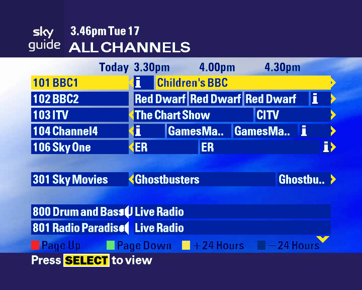
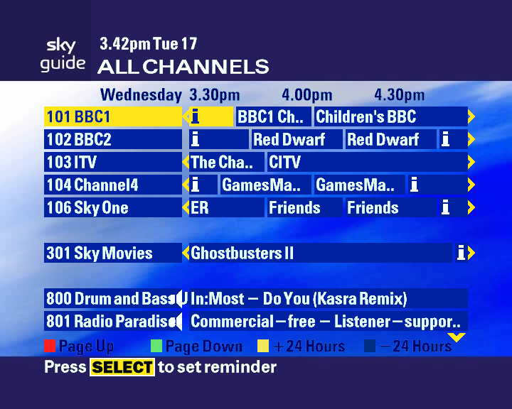
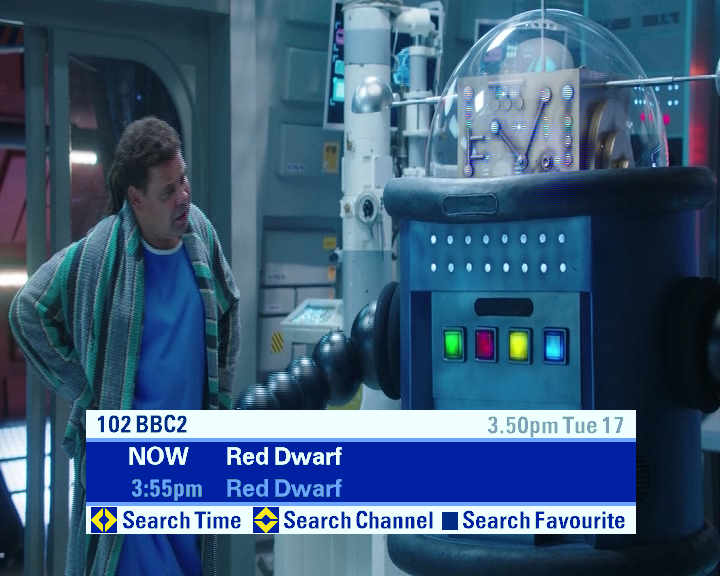
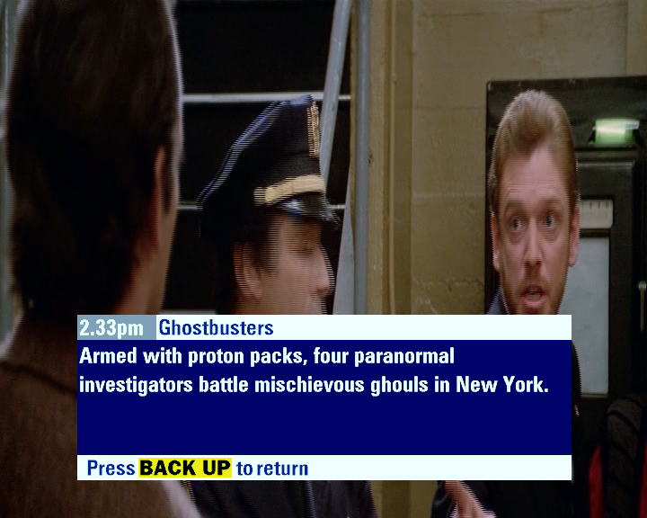
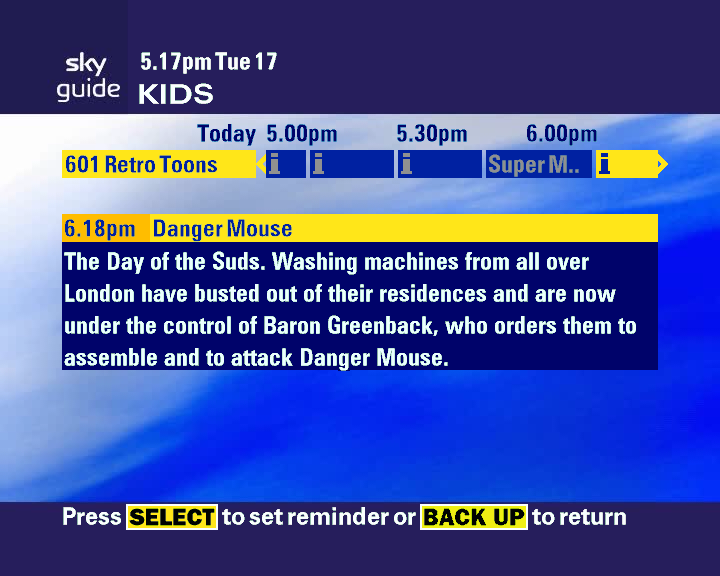

# Pace 2500N Sky Digibox for MiSTer — user guide

A MiSTer FPGA core that runs the **genuine Pace 2500N (Sky Digibox) firmware**:
the real Sky Guide boots, reads its listings from a transport stream and plays
MPEG-2 video with MP2 sound through the box's own decoder path. Channels are
served live from your PC (and optionally your Plex library), transcoded only
while the box is tuned to them, with period adverts and continuity between
programmes.

> This guide is kept current with every change. Developer and reverse-engineering
> notes are in `CURRENT_STATUS.md`, `handoff.md` and `re/`.

**Downloads:** [Releases](https://github.com/retrorepair/Pace2500N-MiSTer/releases)
(**v0.7.7-rc3**, release candidate) — `Pace2500N_V077.rbf` (the core),
`Pace2500N-MiSTer-files-v0.7.7-rc3.zip` (launcher and relay) and
`PaceChannelBuilder-v0.7.7-rc3-windows.zip` (the Windows app). The last
stable release is v0.7.5 (v0.7.4 core). Supply your own firmware and Guide
checkpoint.

## Screenshots

Captured from the core on a MiSTer (v0.7.7-rc2), firmware-drawn Sky Guide over live playout:

| | |
|---|---|
|  TV Guide |  All Channels |
|  7-day listings (+24 Hours) |  Genre page |
|  Music & Radio with live track titles |  Programme synopsis from Plex |
|  Now/next banner |  Information while watching |
|  Internet radio station tuned |  IPTV channel with its own guide (Pluto TV) |

## What works

| Area | State |
|------|-------|
| Firmware boot, Sky Guide, listings (TV Guide, A–Z, All Channels) | working |
| Running broadcast clock (from the MiSTer's RTC) | working |
| MPEG-2 video + MP2 audio, selected by the firmware when you pick a channel | working (v0.5.8+) |
| Streaming from the server share (file mode, any length) | working (v0.5.9; v0.6.1 adds tuner lock) |
| **Live channels from the PC playout server** — guide listings, channel numbers, now/next banner | **working (v0.6.1)** |
| Live channels — picture and sound of the channel you select, changing channel | **working (v0.6.2)** — the MPEG decoder's interrupts and header registers are now modelled |
| Core contains no firmware (boots from the flash dump it loads) — downloadable | **v0.6.3** |
| **New CPU**: pipelined NEC VR4110 with instruction and data caches, MIPS16, 75 MHz (~70 million instructions/s, the old CPU managed ~5) | **v0.7.0** |
| Keys respond straight away; TV Guide, Box Office and Services menus; back to the Guide from a channel | **working (v0.7.0)** |
| Interactive | shows the firmware's "no interactive services available" (none are broadcast) |
| Typing a channel number | **working** with the current Channel Builder (17 Nov): TV and radio. Each channel needs its own number - Channel Builder refuses a number that is already used |
| Guide genre pages (Movies, Entertainment, ...) | working: each channel's **Guide genre** in Channel Builder, Automatic from Plex by default (Movies and Entertainment verified) |
| Live TV channels from internet streams (IPTV) | working (Channel Builder **Add IPTV**): picture, sound, typed number, banner; schedule and synopses from XMLTV, automatic for ~100 UK channels (Pluto TV, Plex, Samsung TV Plus) |
| Reminders | working from the Guide grids (All Channels and the genre pages): Select on a future programme adds it to the Personal Planner, overlaps get the box's own Reminder Clash screen, and at the start time the box shows "This programme is about to start" with Select to switch channel. Select in the channel banner's look-ahead does not add a booking yet |
| Widescreen pictures on a 4:3 TV | MiSTer OSD option **Widescreen on 4:3** letterboxes 16:9 and wider (v0.7.6) |
| Sound recovering after a damaged MP2 frame | about 50-75 ms instead of silence for the rest of the stream (v0.7.7, verified in simulation) |
| TV sound in the EPG | muted while the firmware tunes to the Guide transponder |
| Plex library as a programme source (single titles or whole libraries) | working (Sky Movies from Plex, v0.7.0) |
| 7-day listings | working: set **Days of listings** to 7 in Channel Builder's Settings. A day not viewed yet fills within a few seconds of opening it |
| Programme synopsis (Information button) | working while tuned and in the grid for Plex titles that have a summary (cut to 255 characters, the box's limit) |
| EPG background music | the updated relay keeps music playing across Guide, All Channels, Box Office and Services when a period audio file is configured. Sky returns to the TV channel. Background Music is in Services > System Setup > Sound Settings |
| Teletext/VBI, A/V lip-sync | not yet |

## How it fits together

```
 Plex / files ──► PC: playout server ──► network ──► MiSTer HPS: relay ──► /tmp ring ──► core ──► firmware
 (sources)        (transcode on demand,               (pace_live_relay.py)  (image slot)   (demux,
                   guide data, adverts)                                                     MPEG decoder)
```

- **Channels are pure metadata** — a JSON line-up listing each channel's
  programmes, style and interstitial sets. No video files are made.
- **The box tunes, the PC plays.** When the firmware routes a channel's PIDs to
  its decoder, the core reports them; the relay asks the PC for that channel;
  the PC transcodes *what the schedule says is on now* and streams it. Change
  channel or leave the core and the transcode stops. Nothing is "on air" unless
  the box has tuned it. The home transponder carries listings and configured
  Guide music. The playout server levels programmes and breaks toward −24 LUFS
  and Guide music toward −34 LUFS.
- **Period breaks.** ITV-style channels get centre and end breaks of real
  period adverts; Sky-style channels get Sky-length breaks; BBC-style channels
  get continuity (announcers, trailers, idents) and no adverts. Breaks are
  contiguous runs of spots exactly as they were recorded off air.

## 1. Install the core on the MiSTer

Copy to the MiSTer SD card:

| File | Where |
|------|-------|
| `Pace2500N_V077.rbf` | `/media/fat/_Other/` |
| `Pace2500N_V077_Live.mgl` (in the MiSTer files zip) | `/media/fat/_Other/` |
| Your firmware `FLASH_U202.bin` | `/media/fat/games/Pace2500N/` |
| Guide checkpoint `RAM.bin`, `STATE.bin` | `/media/fat/games/Pace2500N_GUIDE/` |

The firmware and checkpoint images are not distributed; they come from your own box.
The core boots entirely from the `FLASH_U202.bin` it loads - nothing from the
box is built into it.

## 2. The Windows app: Pace Channel Builder

A normal Windows program - nothing else to install (Python, ffmpeg and yt-dlp
are inside its folder).

- **Get it:** unzip `PaceChannelBuilder-v0.7.7-rc3-windows.zip` from
  [Releases](https://github.com/retrorepair/Pace2500N-MiSTer/releases) anywhere
  (e.g. `C:\PaceChannelBuilder`) and run `PaceChannelBuilder.exe`. Keep the
  whole folder together. Windows SmartScreen may warn the first time (the exe
  is not code-signed): *More info* -> *Run anyway*.
- **Run it:** *Pace Channel Builder* on the Desktop / Start menu, or
  `PaceChannelBuilder.exe` in that folder.
- **Upgrading:** close the app (it asks first while playout is running - the
  box loses its channels until you reopen it), replace the folder, start it
  again. Your settings, line-ups and adverts are kept (they are not in the
  app folder).
- **If something goes wrong:** the app writes `%APPDATA%\Pace2500N\app.log`
  (everything it did, errors, and a full dump if playout stops answering).
  The *Playout* tab shows whether the box is connected and when it last was.
- **Plex:** *Settings* tab -> **Sign in with Plex...**. Your browser opens Plex's
  own sign-in page; approve *Pace Channel Builder* and the app receives the
  token and finds your server by itself. You never copy a token by hand.
  (*Test connection* lists your libraries.)
- **Playout runs inside the app** and starts when the app opens (tick box in
  Settings). The *Playout* tab shows what each channel is showing and what is
  being streamed to the box. Keep the app open while you use the box.
- First time only: allow it through Windows Firewall if asked (the MiSTer
  connects to port 8250).
- Settings live in `%APPDATA%\Pace2500N\settings.json` (never in the project
  or on GitHub). The *Data folder* holds line-ups and `roms\` (ripped adverts).

To rebuild the app from source: `tools\build_app.bat` (needs Python and
PyInstaller on the build machine only; close the app first).

## 3. Install the relay on the MiSTer (once)

The two files are in the MiSTer files zip (or
`tools/mister/` in the source). From that folder on the PC (`MISTER` is the
MiSTer's address; the last address is your PC's LAN address, which the app's
Playout tab shows):

```bash
scp pace_live_relay.py install_relay.sh root@MISTER:/tmp/
```

```bash
ssh root@MISTER "sh /tmp/install_relay.sh 192.168.1.247:8250"
```

This puts the relay in `/media/fat/linux/pace/`, writes `relay.ini` (the PC
address — edit it if your PC's address changes) and adds one line to
`/media/fat/linux/user-startup.sh` so it starts at boot. It is idle until the
Pace core runs. Its log is `/tmp/pace_live_relay.log`. To upgrade, run the same
two commands with the new files; the old relay is stopped first.

## 4. Build channels

In the app:

- **Channels** - *Add* a channel; set its name, number, **style** (BBC style:
  continuity, no adverts / ITV style: terrestrial advert breaks / Sky style:
  satellite breaks), when its broadcast day starts, and tick the advert /
  continuity sets it uses. Add programmes with *Add files...* or
  *Add from Plex...* (pick a library, then a show and episodes - or **Add the
  whole library**: every film, or every episode of a TV library). The list
  repeats to fill the day. **Every change is saved as you make it** (the line-up
  file is shown at the top of the tab; a new one is `roms\lineup.json`), and a
  running playout picks it up a couple of seconds later - no Save or restart
  needed. A channel with no programmes yet stays off air.
- **Adverts & continuity** - search YouTube (e.g. `TVS adverts 1987`,
  `BBC1 continuity 1989`, `Sky One adverts 1994`), select results and *Rip
  selected* into a set named for the station and years. Videos you downloaded
  yourself go in with *Import videos into set...*.
  Long compilations (a whole evening's breaks in one video) are split
  automatically at the cuts between items - black frames with silence, black
  frames alone on hissy tapes, announcer pauses in long continuity. Select a set
  to see every spot with its time and length: *Play* (or double-click) previews
  it, *Exclude / include* drops anything that is not an advert, ident or
  continuity. Breaks use runs of spots exactly as they were broadcast, and never
  run across an excluded or over-long segment (e.g. a programme excerpt).
- **Live TV channels (IPTV)** - on the **Channels** tab choose **Add IPTV**. A picker loads an
  [iptv-org](https://github.com/iptv-org/iptv) country list (UK by default); search it, keep
  *Official sources only* ticked, select channels and **Add selected**. Each gets a Guide genre
  from the list's category and a number in Sky's block for it (Kids 601+, Movies 301+, Sports
  401+, News 501+, Entertainment 101+), and the stream is checked (see the Playout log). Or use
  *Paste a stream URL instead* for any `.m3u8` or MPEG-TS address. Use official free channels, e.g. from the
  [Free-TV](https://github.com/Free-TV/IPTV) or [iptv-org](https://github.com/iptv-org/iptv)
  lists (Pluto TV, Samsung TV Plus, the BBC's own UK streams); many other entries in those lists
  are unofficial re-streams of paid channels. The stream is converted only while the box is
  tuned to it. The picker's *Listings* column shows which channels come with a programme
  guide: their real schedule and synopses are fetched automatically from the XMLTV guides
  [i.mjh.nz](https://i.mjh.nz) publishes for Pluto TV, Plex, Samsung TV Plus and others
  (about 100 of the ~170 official UK channels), matched by the channel's iptv-org id. For any
  other stream add `"epg": {"url": "<XMLTV file>", "id": "<channel id>"}` to the channel in the
  line-up file. Without a guide the Guide rows read "Live TV". Tested: Pluto TV Retro Toons on
  601 and Tiny Pop on 602, with listings on All Channels and the Kids page and synopses in Info.
- **Internet radio** - open the **Music & Radio** tab. Choose *Add starter
  stations* for channels 801–809, or *New* to enter a channel number in
  800–899, a station name and a direct HTTP(S) audio-stream URL. *Save station*
  adds it to the current line-up. On the MiSTer, use **TV Guide → Music &
  Radio** (F1, then 7) or enter the channel number. The updated Playout app
  and MiSTer relay send audio to the existing v0.7.4 core when you tune a
  station. The app polls the stream for ICY metadata while playout is running.
  A station's current track appears in the app and in the Guide's current
  slot. Reopen Music & Radio to refresh the firmware's grid. Other slots and
  stations without track metadata show *Live Radio*.
- **Schedule** - *Show today's guide* lists exactly what the box will show.
  *Find natural breaks* (once per programme, slow) moves ITV/Sky centre breaks
  to the programme's own fade-to-black points.

For scripting there are command-line equivalents (`tools/pace_channels.py`,
`tools/pace_playout.py`); a sample line-up is `tools/lineup.example.json`.
`tools/radio.example.json` is a sample value for the line-up's `radio` field.

## 5. Watch

1. Open **Pace Channel Builder** on the PC (playout starts with it).
2. On the MiSTer load your matching **Pace2500N Live** launcher. The firmware
   starts gathering listings in the background. On v0.7.4 the grid can fill
   while All Channels is open. The first acquisition took about 75 seconds
   after a cold launch. Later visits showed the grid in the first two-second
   capture.
3. Press **TV Guide** (F1), choose **All Channels**, highlight a channel and
   press **Select** (Enter). After a few seconds (the PC starts the transcode at
   the scheduled point) the picture and sound appear.
   Keyboard/remote mapping: `KEYBOARD_REMOTE_MAP.md`.
4. To change channel, press TV Guide again and pick another one.

Channel numbering in the line-up maps to the box's services: channel *n*
(0-based) is SID 1001+n, video PID 0x200+0x10·n, audio PID 0x102+0x10·n.

## Troubleshooting

| Symptom | Check |
|---------|-------|
| Guide has no listings | Is the app open with playout *Running*? `/tmp/pace_live_relay.log` on the MiSTer shows `tuned:` lines and connection errors. |
| Relay can't reach the PC | `relay.ini` address (the app shows this PC's address on its Playout tab); Windows Firewall rule for the app on port 8250. |
| Picture freezes | Status page *Streaming* section; network speed (6.25 Mbit/s needed). |
| Wrong programme for the time | The MiSTer's clock (RTC) drives the guide; the PC uses its own clock — keep both on NTP. |

## Building the core

Quartus Prime Lite 17.0.2 (Cyclone V).

The root project builds the Live core. Its VHDL CPU is in `rtl/r4k/`.
See `rtl/r4k/UPSTREAM.md` for its origin. Load the flash and checkpoint
at runtime. Build from the repository root with the release fitter options:

```text
quartus_sh -t sys/build_id.tcl compile Pace2500N Pace2500N
quartus_map --read_settings_files=on --write_settings_files=off Pace2500N -c Pace2500N
quartus_fit Pace2500N --read_settings_files=on --write_settings_files=off --set=PHYSICAL_SYNTHESIS_COMBO_LOGIC=OFF --set=PHYSICAL_SYNTHESIS_COMBO_LOGIC_FOR_AREA=OFF
quartus_asm Pace2500N
quartus_sta Pace2500N
quartus_cpf -c -o bitstream_compression=on output_files/Pace2500N.sof output_files/Pace2500N_V077.rbf
```

Older development tops (`rtl/Pace2500N.sv`, `rtl/Pace2500N_Guide.sv`) still
cold-boot from an in-fabric boot ROM: make it from your own dump with
`python tools/make_bootrom.py` (writes `rom/bootloader_words.hex`). Those
builds contain firmware and must not be shared.

Development build trees live in `builds/` (not in git). Simulation benches are
in `sim/` (`iverilog -g2012`; e.g. `sim/tb_ts_live.sv`, `sim/tb_ts_stream.sv`).
The v0.7.0 CPU has its own: `sim/r4k/` (GHDL, the CPU alone against a reference
trace) and `sim/vl/` (Verilator: the CPU in the whole system with a transport
stream, checked instruction by instruction against the old CPU; `sim/vl/build.sh`).

The MPEG-2 decoder is from MiSTer_DVD (mpeg2fpga, GPL-3). The MiSTer
framework in `sys/` is GPL; see `LICENSE`.
